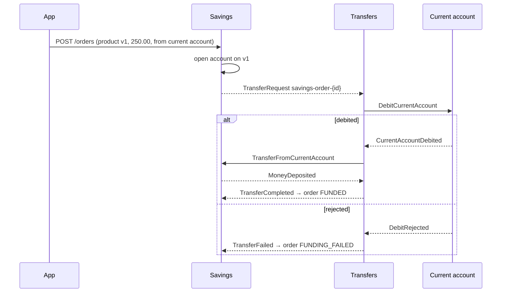

# savings-platform

Savings products, investments and current accounts in an event-driven architecture. A customer
orders a savings product and funds it from their current account, or buys ETFs and stocks for an
amount of money. The transfer service moves the money between the ledgers, interest accrues daily and
is paid per the product's payout period, and orders reach a broker over FIX. Built to be **correct and
auditable** first, and as simple as that allows.

## The big picture


Topics: `transfer-requests` = `payments.transfer-requests.v1`, `savings-instructions` =
`payments.savings-instructions.v1`, `account-events` = `savings.account-events.v1`, `transfer-events` =
`payments.transfer-events.v1`, `ca-instructions` = `payments.current-account-instructions.v1`,
`ca-events` = `current-account.events.v1`, `postings` = `savings.postings.v1` and
`investments.postings.v1`, `investment-instructions` = `payments.investment-instructions.v1`,
`portfolio-events` = `investments.account-events.v1`, `broker-orders` = `broker.orders.v1`,
`broker-executions` = `broker.executions.v1`. Until the API gateway exists, the app calls each service
directly. Each service's REST commands go through its own input topic (`savings.commands.v1`,
`current-account.commands.v1`, `investments.commands.v1`, `payments.transfer-requests.v1`), left out of
the picture. The planned parts are what [ADR 0001](docs/adr/0001-scope-savings-only.md) leaves out and
[0021](docs/adr/0021-current-account-service.md) defers.

Five services, each owning its data, connected only through Kafka contracts
([ADR 0018](docs/adr/0018-service-structure.md)):

- **savings-service** sells products and keeps the savings ledger. An order opens an account on the
  product version the customer accepted, then asks the transfer service for the money
  ([0020](docs/adr/0020-open-and-fund-a-savings-product.md)).
- **transfer-service** moves money between two accounts of the same customer as a saga with
  compensation. It knows accounts (owner, ledger) from the ledgers' events, never products.
- **current-account-service** keeps current accounts and their ledger: balance, overdraft limit,
  blocking, incoming payments from outside the bank. It answers the transfer service's debits and
  credits, and decides on its own rules whether money may leave
  ([0021](docs/adr/0021-current-account-service.md)).
- **investment-service** keeps portfolios: a buy pulls its money from the current account first, then
  goes to the broker; holdings are FIFO lots; refunds and proceeds go back to the current account
  ([0026](docs/adr/0026-investment-service.md)). To the transfer service a portfolio is an account of a
  third ledger ([0028](docs/adr/0028-investments-as-a-third-ledger.md)).
- **fix-gateway** holds the one FIX 4.4 session to the broker and translates between it and Kafka:
  each order placed once, each report published once ([0027](docs/adr/0027-fix-gateway.md)).

Every state change starts as a message on a service's own input topic. REST accepts commands into
that log (`202 Accepted`) and answers queries, so a service's inputs can be replayed
([0019](docs/adr/0019-state-changes-through-a-command-log.md)).

## Assumptions about the ledger

What the design takes as given about money records. Each is recorded in an ADR, and changing it
would change the design.

- **Savings keeps a customer ledger, not the bank's books.** The `ledger_entry` table is a
  *single-entry* record per account: signed amount, balance after, business reference. It is the
  customer's view and the source of truth for balances, statements and interest. The bank's
  **general ledger is a separate system owned by Finance**; Savings is a sub-ledger that feeds it
  ([ADR 0004](docs/adr/0004-money-and-append-only-ledger.md),
  [0014](docs/adr/0014-double-entry-postings-for-finance.md)).
- **No double-entry bookkeeping inside Savings.** There is no journal, no chart of accounts and no
  trial balance here. Every booking and every daily interest accrual is *published* as a balanced
  double-entry posting on logical book accounts (`customer:<id>`, `transfer-clearing`,
  `interest-expense`, `interest-payable`); Finance maps them to its chart of accounts and keeps the
  books. What Finance can reconcile against Savings: the customer lines of an account sum to that
  account's ledger balance ([0014](docs/adr/0014-double-entry-postings-for-finance.md)).
  `transfer-clearing` is meant to net to zero per transfer *across* the two ledgers, but only
  savings publishes postings so far: savings' own lines net to zero only for a withdrawal the
  current account refused and savings got back. That check becomes possible once the current
  account publishes its side ([0018](docs/adr/0018-service-structure.md),
  [0021](docs/adr/0021-current-account-service.md)). A full double-entry core inside
  Savings was considered and rejected as more than one product needs.
- **The ledger is the system of record, not the Kafka log.** Replaying inputs is for recovery and
  verification; history is never re-booked by new code
  ([0019](docs/adr/0019-state-changes-through-a-command-log.md)).
- **One ledger per product, no shared database.** A transfer between the current account and
  savings is a saga across two ledgers, not one transaction
  ([0015](docs/adr/0015-transfers-only-with-the-current-account.md),
  [0018](docs/adr/0018-service-structure.md)).

## What it does

- **Products**: savings products (`INSTANT_ACCESS`, `QUARTERLY_INTEREST`, `YEARLY_INTEREST`) come
  from Flyway reference data in immutable versions: annual rate and payout frequency. New terms are
  a new version.
- **Orders**: `POST /orders` with the product version the customer accepted, an amount and the
  current account to take it from. Savings opens the account on those terms, so they are fixed
  before any money moves, and requests a transfer. The order ends up `FUNDED`, `FUNDING_FAILED`
  (the account stays open and empty) or `REJECTED` (terms no longer sold).
- **Transfers**: only between a customer's current account and their savings. The source is
  debited first, then the target credited. If the current account refuses a credit, savings gets the
  money back. A request for an account the transfer service doesn't know yet waits for its opening
  event, and fails after 10 minutes.
- **Current accounts**: opened with an overdraft limit. Incoming payments (a salary) are booked
  once per payment id. A debit is carried out if the balance stays within the overdraft limit,
  otherwise rejected. A blocked account refuses transfers both ways.
- **Savings balances never go negative**: a withdrawal is debited at once if the balance allows
  it, otherwise rejected.
- **Interest**: ACT/365 on each day's closing balance, accrued nightly with sub-cent precision,
  credited at the end of the product's payout period (month, quarter or year), rounded down to the
  cent, with the remainder carried over.
- **Bookkeeping for Finance**: every booking and every daily accrual is also published as a balanced
  double-entry posting, so the bank's general ledger can be kept and reconciled from it.
- **Investments**: a portfolio is opened for a customer and their current account. A buy names an
  amount of money (at least 1.00) and an ETF or stock by ISIN; the money is pulled from the current
  account, then the market order goes to the broker, which fills fractional units. Whatever isn't
  spent (partly filled, expired, rejected) is refunded. A sell names units; it may only take units not
  reserved by other open sells, takes the oldest lots first and records the realised gain; the
  proceeds go to the current account. A refund or payout the current account refuses (blocked) stays
  on the portfolio as unpaid, and is retried when the account is unblocked and once a day.



## Other assumptions

- **Money only moves between a customer's current account and their savings or portfolio**, so
  every transfer has a known outcome at once, and there are no holds
  ([0015](docs/adr/0015-transfers-only-with-the-current-account.md), [0028](docs/adr/0028-investments-as-a-third-ledger.md)).
  What is uncertain is a securities order, and that uncertainty stays inside investments and the
  gateway ([0026](docs/adr/0026-investment-service.md)).
- **Investments have no cash account, market data, fees, taxes, dividends, limit orders or
  cancellation yet**; every weekday is a trading day ([0026](docs/adr/0026-investment-service.md)).
- **The transfer service knows accounts, not products**: whether a product allows a withdrawal is
  the product's answer ([0018](docs/adr/0018-service-structure.md)).
- **An account keeps its product version's terms for life**: new rates apply to new accounts only.
  Products differ in rate and payout frequency, not yet in notice periods, terms or rate tiers
  ([0017](docs/adr/0017-savings-products.md)).
- **Replay is not complete yet.** Savings books payment instructions at processing time (the
  current account books them as of the instruction), event ids are random, and interest runs on
  the wall clock
  ([0019](docs/adr/0019-state-changes-through-a-command-log.md) lists what's missing).
- **The current account is a ledger, not a bank account product**: no overdraft interest, fees,
  statements, limit changes or postings for Finance yet
  ([0021](docs/adr/0021-current-account-service.md)).
- **One currency (EUR), one business time zone (Europe/Berlin)**; no taxes, campaigns, account
  closing or authentication ([0001](docs/adr/0001-scope-savings-only.md)).

## Where the interesting decisions are

| Concern | How | Read |
|---|---|---|
| Service boundaries | Savings, transfers, current account; each owns its ledger; savings modular inside, with recorded triggers for a split | [0018](docs/adr/0018-service-structure.md) |
| Replayable inputs | State changes only through each service's command log; REST accepts (`202`) and queries; ids chosen by the client | [0019](docs/adr/0019-state-changes-through-a-command-log.md) |
| Opening a product | One order: open the account on the accepted terms, then request the money; ids derived from the order | [0020](docs/adr/0020-open-and-fund-a-savings-product.md) |
| Distributed workflow | Transfers as a saga with one compensating step; why no holds | [0015](docs/adr/0015-transfers-only-with-the-current-account.md) |
| Whose rule is it | The current account decides on overdraft and blocking; the transfer service only learns the answer | [0021](docs/adr/0021-current-account-service.md) |
| Exact money | `BigDecimal` value object, strings on the wire, rounding (down) only at payout | [0004](docs/adr/0004-money-and-append-only-ledger.md) |
| Auditability | Append-only ledger with `balance_after`; daily accrual rows | [0004](docs/adr/0004-money-and-append-only-ledger.md), [0010](docs/adr/0010-interest-accrual-and-payout.md) |
| Books that balance | Every booking published as a double-entry posting, balanced by construction, value-dated | [0014](docs/adr/0014-double-entry-postings-for-finance.md) |
| No lost or phantom events | Transactional outbox, single ordered relay, in every service | [0006](docs/adr/0006-transactional-outbox.md) |
| Shared code, not shared domains | One technical library for outbox, idempotency, retention, dead letters; `Money` and all domain types stay per service | [0022](docs/adr/0022-shared-technical-library.md) |
| At-least-once delivery | De-duplication by message id and by transfer id in the business transaction; retries; dead-letter topics | [0007](docs/adr/0007-idempotent-consumer-and-dead-letters.md) |
| Concurrency | Per-account ordering via partition key, optimistic locking, DB constraints, per-account entry numbers; advisory locks so a request and its account's opening event can't miss each other; row locks on current accounts | [0008](docs/adr/0008-ordering-and-concurrency.md), [0011](docs/adr/0011-ledger-partitioning-and-keyset-pagination.md) |
| Big tables | Monthly partitions, one composite index, keyset pagination | [0011](docs/adr/0011-ledger-partitioning-and-keyset-pagination.md) |
| Products | Immutable product versions from a catalogue; accounts keep theirs; terms composed, not subclassed | [0017](docs/adr/0017-savings-products.md) |
| Contracts | Protobuf envelope with `oneof`, additive evolution, anti-corruption layer | [0005](docs/adr/0005-protobuf-event-contracts.md) |
| Architecture | Hexagonal layers; plain-Java domain; services never import each other; enforced by Checkstyle import control and ArchUnit | [0003](docs/adr/0003-hexagonal-layers-with-jpa-on-the-domain.md), [0016](docs/adr/0016-domain-model-separate-from-jpa-entities.md) |
| Delivery | Acceptance tests first, real infrastructure in tests | [0012](docs/adr/0012-acceptance-tests-first.md) |
| Operations | Business metrics, dashboard, alerts | [0013](docs/adr/0013-observability.md) |
| Investments | Buys by amount, money first, then the broker; FIFO lots; refunds and proceeds as payouts that may come back unpaid | [0026](docs/adr/0026-investment-service.md) |
| A third ledger | Portfolios take savings' instructions on a topic of their own; the transfer service still knows no products | [0028](docs/adr/0028-investments-as-a-third-ledger.md) |
| FIX to a broker | A gateway owns the session; orders marked before they leave, status requests after every logon, reports de-duplicated by exec id | [0027](docs/adr/0027-fix-gateway.md) |
| What's left out, and why | Taxes, campaigns, auth, S3, ... | [0001](docs/adr/0001-scope-savings-only.md), [0026](docs/adr/0026-investment-service.md) |

All decisions: [docs/adr](docs/adr/README.md) · Vocabulary: [docs/GLOSSARY.md](docs/GLOSSARY.md)

## Stack and build

Java 25 · Spring Boot 4.2 · Hibernate 7 · Flyway · PostgreSQL 17 · Kafka 4 · Protobuf ·
QuickFIX/J (FIX 4.4) · Micrometer/Prometheus/Grafana · JUnit 6 · AssertJ · Mockito · Testcontainers · Karate · ArchUnit ·
Checkstyle · GitHub Actions

```
./gradlew build          # Checkstyle, unit, architecture and acceptance tests of all services (needs Docker)
```

Test methods are named `methodUnderTest_Given_Expected`, e.g. `debit_OneCentBeyondOverdraftLimit_IsRejected`;
Checkstyle (`TestMethodName`) refuses any other name for a `@Test`, `@ParameterizedTest` or `@Karate.Test` method.

## Repository layout

```
events-proto/               Protobuf contracts, one package per owning team: savings.v1, payments.v1, current_account.v1
platform-messaging/         technical library: outbox and relay, idempotent consumer, retention, dead letters, wire checks
savings-service/
  domain/                   Account, LedgerEntry, Posting, Money, Interest, SavingsProduct; order/ Order
  application/              use cases and the ports they need; order/ OrderService
  adapter/                  web · messaging · persistence (JPA entities, kept package-private) · scheduling · metrics
  resources/db/             Flyway migrations
transfer-service/
  domain/                   Transfer (the saga), Step, KnownAccount, Money
  application/              TransferService and its ports
  adapter/                  web · messaging (listeners, outbox) · persistence (JDBC) · scheduling
current-account-service/
  domain/                   CurrentAccount, Booking, TransferAnswer, IncomingPayment, Money
  application/              CurrentAccountService and its ports
  adapter/                  web · messaging (listeners, command log, outbox) · persistence (JDBC)
investment-service/
  domain/                   Portfolio, CashEntry, Order, Fill, Holding, Lot, Payout, Posting, Money, Quantity, Price
  application/              InvestmentService, MoneyMovements, Executions and their ports
  adapter/                  web · messaging · persistence (JDBC) · scheduling · metrics
fix-gateway/
  domain/                   BrokerOrder
  application/              GatewayService, Dispatcher and their ports
  adapter/                  fix (QuickFIX/J, the session) · messaging · persistence (JDBC) · scheduling
execution-simulator/        plays the broker locally: a FIX 4.4 acceptor that fills at fixed prices
ops/                        Prometheus config and alerts, Grafana provisioning and dashboard
config/checkstyle/          code style and import-control.xml (which layer and service may import what)
docs/                       ADRs and glossary
```

## The specification

The acceptance features are the best entry point into the behaviour.

Savings ([features](savings-service/src/test/resources/acceptance)):

- [orders.feature](savings-service/src/test/resources/acceptance/orders.feature): an order opens the account and requests the money; funded, failed, rejected; idempotent `POST`
- [products.feature](savings-service/src/test/resources/acceptance/products.feature): products on sale, new versions, stale terms refused, accounts keeping theirs
- [deposits.feature](savings-service/src/test/resources/acceptance/deposits.feature): crediting, redelivery and re-sent transfers applied once, reused transfer id → DLT, paginated statement
- [withdrawals.feature](savings-service/src/test/resources/acceptance/withdrawals.feature): immediate debit, rejection, no double spend, return once, contract violations → DLT
- [interest.feature](savings-service/src/test/resources/acceptance/interest.feature): monthly and quarterly payout, catch-up from closing balances, carried remainders
- [postings.feature](savings-service/src/test/resources/acceptance/postings.feature): double-entry postings for deposits, withdrawals and returns, daily accruals and payouts

Transfers:

- [transfers.feature](transfer-service/src/test/resources/acceptance/transfers.feature): both directions, rejected debit, refused credit and its return, waiting for an account, timeouts, ownership, idempotent `POST`, reused transfer id → DLT

Current accounts:

- [accounts.feature](current-account-service/src/test/resources/acceptance/accounts.feature): opening, incoming payments booked once, unknown accounts, blocking and unblocking, validation
- [transfers.feature](current-account-service/src/test/resources/acceptance/transfers.feature): debits within and beyond the overdraft, credits, blocked accounts, instructions answered once, reused transfer id → DLT

Investments:

- [portfolios.feature](investment-service/src/test/resources/acceptance/portfolios.feature): opening, idempotent `POST`, instruments on sale
- [buys.feature](investment-service/src/test/resources/acceptance/buys.feature): money first, fills, refunds of what wasn't spent, funding failed, rejected and off-sale instruments, postings, duplicate fills, fills beyond the money → DLT, money nobody ordered paid back
- [sells.feature](investment-service/src/test/resources/acceptance/sells.feature): FIFO lots and realised gains, reserved units, expiry releasing units, selling off-sale instruments
- [payouts.feature](investment-service/src/test/resources/acceptance/payouts.feature): a refused refund coming back unpaid, retried on unblocking and daily, withdrawals only for payouts asked for

FIX gateway:

- [orders.feature](fix-gateway/src/test/resources/acceptance/orders.feature): `NewOrderSingle` for buys and sells, reports in order, placed once, fills reported once, rejection, expiry, cancellation, duplicate rejections, expiry before sending
- [session.feature](fix-gateway/src/test/resources/acceptance/session.feature): orders waiting while the session is down, status requests after a logon, an order the broker lost

## Running it locally

```bash
./gradlew bootJar
docker compose up --build
```

| What | Where |
|---|---|
| Savings API docs | http://localhost:8080/swagger-ui.html |
| Transfers API docs | http://localhost:8081/swagger-ui.html |
| Current accounts API docs | http://localhost:8082/swagger-ui.html |
| Investments API docs | http://localhost:8083/swagger-ui.html |
| FIX gateway health | http://localhost:8084/actuator/health |
| Prometheus (alerts) | http://localhost:9090/alerts |
| Grafana (dashboard "Savings") | http://localhost:3000 |

Open a current account and receive a salary, order a product funded from it, then move money back:

```bash
CUSTOMER=3f2b8c1a-5d4e-4f6a-9b7c-1a2b3c4d5e6f
JSON='Content-Type: application/json'
# Every POST that creates something carries an Idempotency-Key; send the same key to retry.
CURRENT=$(curl -s -X POST localhost:8082/current-accounts -H "$JSON" -H "Idempotency-Key: $(uuidgen)" \
  -d "{\"customerId\":\"$CUSTOMER\",\"overdraftLimit\":\"200.00\"}" | jq -r .accountId)
curl -s -X POST localhost:8082/current-accounts/$CURRENT/incoming-payments -H "$JSON" -H 'Idempotency-Key: salary-1' \
  -d '{"amount":"1000.00"}'

ORDER=$(curl -s -X POST localhost:8080/orders -H "$JSON" -H "Idempotency-Key: $(uuidgen)" \
  -d "{\"customerId\":\"$CUSTOMER\",\"productCode\":\"INSTANT_ACCESS\",\"productVersion\":1,\"amount\":\"250.00\",\"fromAccountId\":\"$CURRENT\"}" \
  | jq -r .orderId)
curl -s localhost:8080/orders/$ORDER                    # FUNDING, then FUNDED
SAVINGS=$(curl -s localhost:8080/orders/$ORDER | jq -r .accountId)

curl -s -X POST localhost:8081/transfers -H "$JSON" -H "Idempotency-Key: $(uuidgen)" \
  -d "{\"customerId\":\"$CUSTOMER\",\"fromAccountId\":\"$SAVINGS\",\"toAccountId\":\"$CURRENT\",\"amount\":\"100.00\"}"

curl -s localhost:8080/accounts/$SAVINGS
curl -s localhost:8080/accounts/$SAVINGS/transactions
curl -s localhost:8082/current-accounts/$CURRENT/bookings   # salary, -250.00 for the order, +100.00 back
```

Buy €300 of an ETF from the same current account, then sell part of it (`execution-simulator` fills
at fixed prices):

```bash
PORTFOLIO=$(curl -s -X POST localhost:8083/portfolios -H "$JSON" -H "Idempotency-Key: $(uuidgen)" \
  -d "{\"customerId\":\"$CUSTOMER\",\"referenceAccountId\":\"$CURRENT\"}" | jq -r .portfolioId)
BUY=$(curl -s -X POST localhost:8083/orders -H "$JSON" -H "Idempotency-Key: $(uuidgen)" \
  -d "{\"portfolioId\":\"$PORTFOLIO\",\"isin\":\"IE00B4L5Y983\",\"side\":\"BUY\",\"amount\":\"300.00\"}" | jq -r .orderId)
curl -s localhost:8083/orders/$BUY                      # FUNDING, then FILLED / SETTLED
curl -s -X POST localhost:8083/orders -H "$JSON" -H "Idempotency-Key: $(uuidgen)" \
  -d "{\"portfolioId\":\"$PORTFOLIO\",\"isin\":\"IE00B4L5Y983\",\"side\":\"SELL\",\"quantity\":\"1.5\"}"
curl -s localhost:8083/portfolios/$PORTFOLIO              # holdings: units, FIFO cost basis, last price
curl -s localhost:8083/portfolios/$PORTFOLIO/transactions # FUNDING, BUY, SELL, PAYOUT
```

An order above the current account's balance plus overdraft ends `FUNDING_FAILED` with
"overdraft limit exceeded". Block the account (`PUT .../block`) and a transfer to it fails with
`CREDIT_REFUSED`, its money back in savings.

## REST API

Savings (`:8080`):

| Method | Path | |
|---|---|---|
| `GET` | `/products` | products on sale with their current version: `code`, `version`, `name`, `annualRate`, `payoutFrequency` |
| `POST` | `/orders` | `Idempotency-Key` header, `{ customerId, productCode, productVersion, amount: "250.00", fromAccountId }` → `202` + `Location` and `orderId`, status `RECEIVED`. The same key and order again → `202` with its current state; a different order under the same key → `422` |
| `GET` | `/orders/{orderId}` | `FUNDING`, `FUNDED`, `FUNDING_FAILED` or `REJECTED`, with `accountId`; `404` until the order has been applied |
| `GET` | `/accounts/{id}` | balance, accrued interest and the product version it was opened on; amounts as strings |
| `GET` | `/accounts/{id}/transactions?limit=20&cursor=…` | newest first, keyset-paginated, `nextCursor`; each entry has its `entryNo` (1, 2, 3, ... per account) |

Transfers (`:8081`):

| Method | Path | |
|---|---|---|
| `POST` | `/transfers` | `Idempotency-Key` header, `{ customerId, fromAccountId, toAccountId, amount: "100.00" }` → `202` + `Location` and `transferId` (`tr-…`, derived from the key). Same idempotency rules as orders |
| `GET` | `/transfers/{transferId}` | `AWAITING_ACCOUNTS`, `DEBITING`, `CREDITING`, `RETURNING`, `COMPLETED` or `FAILED` with `failureReason` and `failureDetail` |

Current accounts (`:8082`):

| Method | Path | |
|---|---|---|
| `POST` | `/current-accounts` | `Idempotency-Key` header, `{ customerId, overdraftLimit: "200.00" }` → `202` + `Location` and `accountId`, status `RECEIVED`. Same idempotency rules as orders |
| `GET` | `/current-accounts/{accountId}` | `OPEN` or `BLOCKED`, `balance`, `overdraftLimit`, `available`, `blockReason`; `404` until opened |
| `GET` | `/current-accounts/{accountId}/bookings?limit=50` | newest first: `type` (`INCOMING_PAYMENT`, `TRANSFER_DEBIT`, `TRANSFER_CREDIT`), signed `amount`, `balanceAfter`, `reference` |
| `POST` | `/current-accounts/{accountId}/incoming-payments` | `Idempotency-Key` header (per account), `{ amount }` → `202` + `Location` and `paymentId`; booked once per key; a different payment under the same key → `422` |
| `GET` | `/current-accounts/{accountId}/incoming-payments/{paymentId}` | `BOOKED`, or `REJECTED` with `rejectionReason` (unknown account, or the balance would exceed what the ledger holds) |
| `PUT` / `DELETE` | `/current-accounts/{accountId}/block` | `{ reason }` blocks, `DELETE` unblocks → `202`; `404` for an account that isn't open |

Investments (`:8083`):

| Method | Path | |
|---|---|---|
| `GET` | `/instruments` | instruments on sale: `isin`, `name`, `type` (`ETF`, `STOCK`) |
| `POST` | `/portfolios` | `Idempotency-Key` header, `{ customerId, referenceAccountId }` → `202` + `Location` and `portfolioId`, status `RECEIVED`. Same idempotency rules as orders |
| `GET` | `/portfolios/{portfolioId}` | `holdings` (`quantity`, `reservedForSale`, FIFO `costBasis`, `lastPrice`) and `unpaidPayouts`; `404` until opened |
| `GET` | `/portfolios/{portfolioId}/transactions?limit=20&cursor=…` | the money ledger, newest first: `FUNDING`, `BUY`, `SELL`, `PAYOUT`, `PAYOUT_RETURN`, signed `amount`, `balanceAfter`, trade details and `realizedGain`; `nextCursor` |
| `POST` | `/orders` | `Idempotency-Key` header, `{ portfolioId, isin, side: "BUY", amount: "500.00" }` or `{ …, side: "SELL", quantity: "1.5" }` → `202` + `Location` and `orderId` (`ord-…`). Same idempotency rules as savings orders; `404` for a portfolio that isn't open |
| `GET` | `/orders/{orderId}` | `status` (`FUNDING`, `PLACED`, `PARTIALLY_FILLED`, `FILLED`, `EXPIRED`, `REJECTED`, `FUNDING_FAILED`), `settlement` (`PENDING`, `SETTLED`, `UNPAID`), `filledQuantity`, `filledAmount`, `rejectionReason`, `fills` |

Errors are [RFC 9457](https://www.rfc-editor.org/rfc/rfc9457) problem details. A `POST` without an
`Idempotency-Key` is refused with `400`: the id of what it creates is derived from the key, so the
same key always means the same resource ([ADR 0025](docs/adr/0025-post-with-an-idempotency-key.md)).
When Kafka doesn't confirm a command in time, the request answers `503`. That means *not confirmed*,
not *not accepted*: the command may still land and be applied, so retry with the same key, which never
creates a second one.
