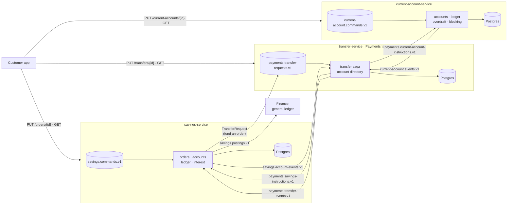
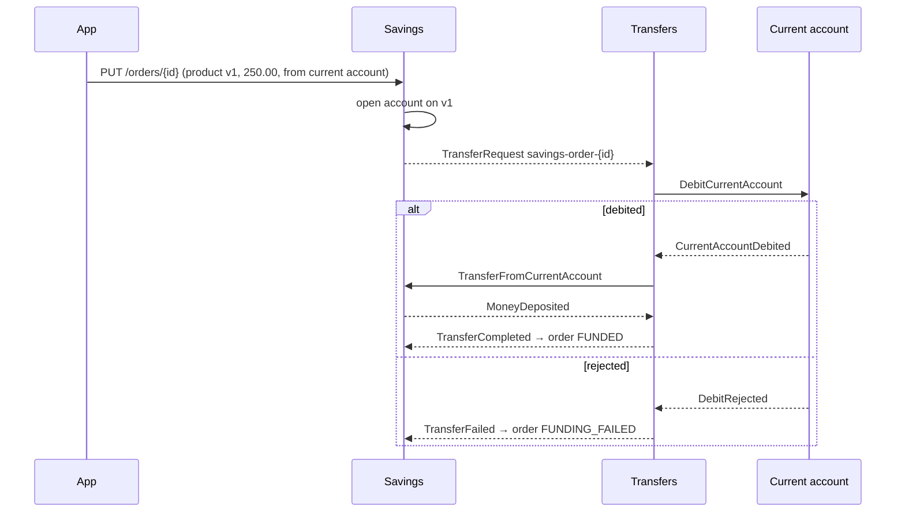

# savings-platform

Savings products and current accounts in an event-driven architecture. A customer orders a savings
product and funds it from their current account. The transfer service moves the money between the
two ledgers, interest accrues daily and is paid per the product's payout period. Built to be **correct and auditable**
first, and as simple as that allows.

## The big picture



Three services, each owning its data, connected only through Kafka contracts
([ADR 0018](docs/adr/0018-service-structure.md)):

- **savings-service** sells products and keeps the savings ledger. An order opens an account on the
  product version the customer accepted, then asks the transfer service for the money
  ([0020](docs/adr/0020-open-and-fund-a-savings-product.md)).
- **transfer-service** moves money between two accounts of the same customer as a saga with
  compensation. It knows accounts (owner, ledger) from the ledgers' events, never products.
- **current-account-service** keeps current accounts and their ledger: balance, overdraft limit,
  blocking, incoming payments from outside the bank. It answers the transfer service's debits and
  credits, and decides on its own rules whether money may leave
  ([0021](docs/adr/0021-current-account-service.md)).

Every state change starts as a message on a service's own input topic. REST accepts commands into
that log (`202 Accepted`) and answers queries, so a service's inputs can be replayed
([0019](docs/adr/0019-state-changes-through-a-command-log.md)).

## Assumptions about the ledger

What the design takes as given about money records. Each is recorded in an ADR, and changing it
would change the design.

- **Savings keeps a customer ledger, not the bank's books.** The `ledger_entry` table is a
  *single-entry* record per account: signed amount, balance after, business reference. It is the
  customer's view and the source of truth for balances, statements and interest. The bank's
  **general ledger is a separate system owned by Finance**; Savings is a sub-ledger that feeds it
  ([ADR 0004](docs/adr/0004-money-and-append-only-ledger.md),
  [0014](docs/adr/0014-double-entry-postings-for-finance.md)).
- **No double-entry bookkeeping inside Savings.** There is no journal, no chart of accounts and no
  trial balance here. Every booking and every daily interest accrual is *published* as a balanced
  double-entry posting on logical book accounts (`customer:<id>`, `transfer-clearing`,
  `interest-expense`, `interest-payable`); Finance maps them to its chart of accounts and keeps the
  books. What Finance can reconcile against Savings: the customer lines of an account sum to that
  account's ledger balance, and `transfer-clearing` nets to zero per transfer
  ([0014](docs/adr/0014-double-entry-postings-for-finance.md)). A full double-entry core inside
  Savings was considered and rejected as more than one product needs.
- **The ledger is the system of record, not the Kafka log.** Replaying inputs is for recovery and
  verification; history is never re-booked by new code
  ([0019](docs/adr/0019-state-changes-through-a-command-log.md)).
- **One ledger per product, no shared database.** A transfer between the current account and
  savings is a saga across two ledgers, not one transaction
  ([0015](docs/adr/0015-transfers-only-with-the-current-account.md),
  [0018](docs/adr/0018-service-structure.md)).

## What it does

- **Products**: savings products (`INSTANT_ACCESS`, `QUARTERLY_INTEREST`, `YEARLY_INTEREST`) come
  from Flyway reference data in immutable versions: annual rate and payout frequency. New terms are
  a new version.
- **Orders**: `PUT /orders/{id}` with the product version the customer accepted, an amount and the
  current account to take it from. Savings opens the account on those terms, so they are fixed
  before any money moves, and requests a transfer. The order ends up `FUNDED`, `FUNDING_FAILED`
  (the account stays open and empty) or `REJECTED` (terms no longer sold).
- **Transfers**: only between a customer's current account and their savings. The source is
  debited first, then the target credited. If the current account refuses a credit, savings gets the
  money back. A request for an account the transfer service doesn't know yet waits for its opening
  event, and fails after 10 minutes.
- **Current accounts**: opened with an overdraft limit. Incoming payments (a salary) are booked
  once per payment id. A debit is carried out if the balance stays within the overdraft limit,
  otherwise rejected. A blocked account refuses transfers both ways.
- **Savings balances never go negative**: a withdrawal is debited at once if the balance allows
  it, otherwise rejected.
- **Interest**: ACT/365 on each day's closing balance, accrued nightly with sub-cent precision,
  credited at the end of the product's payout period (month, quarter or year), rounded down to the
  cent, with the remainder carried over.
- **Bookkeeping for Finance**: every booking and every daily accrual is also published as a balanced
  double-entry posting, so the bank's general ledger can be kept and reconciled from it.



## Other assumptions

- **Money only moves between a customer's current account and their savings**, so every transfer
  has a known outcome at once, and there are no holds
  ([0015](docs/adr/0015-transfers-only-with-the-current-account.md)).
- **The transfer service knows accounts, not products**: whether a product allows a withdrawal is
  the product's answer ([0018](docs/adr/0018-service-structure.md)).
- **An account keeps its product version's terms for life**: new rates apply to new accounts only.
  Products differ in rate and payout frequency, not yet in notice periods, terms or rate tiers
  ([0017](docs/adr/0017-savings-products.md)).
- **Replay is not complete yet.** Savings books payment instructions at processing time (the
  current account books them as of the instruction), event ids are random, and interest runs on
  the wall clock
  ([0019](docs/adr/0019-state-changes-through-a-command-log.md) lists what's missing).
- **The current account is a ledger, not a bank account product**: no overdraft interest, fees,
  statements, limit changes or postings for Finance yet
  ([0021](docs/adr/0021-current-account-service.md)).
- **One currency (EUR), one business time zone (Europe/Berlin)**; no taxes, campaigns, account
  closing or authentication ([0001](docs/adr/0001-scope-savings-only.md)).

## Where the interesting decisions are

| Concern | How | Read |
|---|---|---|
| Service boundaries | Savings, transfers, current account; each owns its ledger; savings modular inside, with recorded triggers for a split | [0018](docs/adr/0018-service-structure.md) |
| Replayable inputs | State changes only through each service's command log; REST accepts (`202`) and queries; ids chosen by the client | [0019](docs/adr/0019-state-changes-through-a-command-log.md) |
| Opening a product | One order: open the account on the accepted terms, then request the money; ids derived from the order | [0020](docs/adr/0020-open-and-fund-a-savings-product.md) |
| Distributed workflow | Transfers as a saga with one compensating step; why no holds | [0015](docs/adr/0015-transfers-only-with-the-current-account.md) |
| Whose rule is it | The current account decides on overdraft and blocking; the transfer service only learns the answer | [0021](docs/adr/0021-current-account-service.md) |
| Exact money | `BigDecimal` value object, strings on the wire, rounding (down) only at payout | [0004](docs/adr/0004-money-and-append-only-ledger.md) |
| Auditability | Append-only ledger with `balance_after`; daily accrual rows | [0004](docs/adr/0004-money-and-append-only-ledger.md), [0010](docs/adr/0010-interest-accrual-and-payout.md) |
| Books that balance | Every booking published as a double-entry posting, balanced by construction, value-dated | [0014](docs/adr/0014-double-entry-postings-for-finance.md) |
| No lost or phantom events | Transactional outbox, single ordered relay, in every service | [0006](docs/adr/0006-transactional-outbox.md) |
| Shared code, not shared domains | One technical library for outbox, idempotency, retention, dead letters; `Money` and all domain types stay per service | [0022](docs/adr/0022-shared-technical-library.md) |
| At-least-once delivery | De-duplication by message id and by transfer id in the business transaction; retries; dead-letter topics | [0007](docs/adr/0007-idempotent-consumer-and-dead-letters.md) |
| Concurrency | Per-account ordering via partition key, optimistic locking, DB constraints, per-account entry numbers; advisory locks so a request and its account's opening event can't miss each other; row locks on current accounts | [0008](docs/adr/0008-ordering-and-concurrency.md), [0011](docs/adr/0011-ledger-partitioning-and-keyset-pagination.md) |
| Big tables | Monthly partitions, one composite index, keyset pagination | [0011](docs/adr/0011-ledger-partitioning-and-keyset-pagination.md) |
| Products | Immutable product versions from a catalogue; accounts keep theirs; terms composed, not subclassed | [0017](docs/adr/0017-savings-products.md) |
| Contracts | Protobuf envelope with `oneof`, additive evolution, anti-corruption layer | [0005](docs/adr/0005-protobuf-event-contracts.md) |
| Architecture | Hexagonal layers; plain-Java domain; services never import each other; enforced by Checkstyle import control and ArchUnit | [0003](docs/adr/0003-hexagonal-layers-with-jpa-on-the-domain.md), [0016](docs/adr/0016-domain-model-separate-from-jpa-entities.md) |
| Delivery | Acceptance tests first, real infrastructure in tests | [0012](docs/adr/0012-acceptance-tests-first.md) |
| Operations | Business metrics, dashboard, alerts | [0013](docs/adr/0013-observability.md) |
| What's left out, and why | Taxes, campaigns, auth, S3, ... | [0001](docs/adr/0001-scope-savings-only.md) |

All decisions: [docs/adr](docs/adr/README.md) · Vocabulary: [docs/GLOSSARY.md](docs/GLOSSARY.md)

## Stack and build

Java 25 · Spring Boot 4.2 · Hibernate 7 · Flyway · PostgreSQL 17 · Kafka 4 · Protobuf ·
Micrometer/Prometheus/Grafana · JUnit 6 · AssertJ · Mockito · Testcontainers · Karate · ArchUnit ·
Checkstyle · GitHub Actions

```
./gradlew build          # Checkstyle, unit, architecture and acceptance tests of all three services (needs Docker)
```

## Repository layout

```
events-proto/               Protobuf contracts, one package per owning team: savings.v1, payments.v1, current_account.v1
platform-messaging/         technical library: outbox and relay, idempotent consumer, retention, dead letters, wire checks
savings-service/
  domain/                   Account, LedgerEntry, Posting, Money, Interest, SavingsProduct; order/ Order
  application/              use cases and the ports they need; order/ OrderService
  adapter/                  web · messaging · persistence (JPA entities, kept package-private) · scheduling · metrics
  resources/db/             Flyway migrations
transfer-service/
  domain/                   Transfer (the saga), Step, KnownAccount, Money
  application/              TransferService and its ports
  adapter/                  web · messaging (listeners, outbox) · persistence (JDBC) · scheduling
current-account-service/
  domain/                   CurrentAccount, Booking, TransferAnswer, IncomingPayment, Money
  application/              CurrentAccountService and its ports
  adapter/                  web · messaging (listeners, command log, outbox) · persistence (JDBC)
ops/                        Prometheus config and alerts, Grafana provisioning and dashboard
config/checkstyle/          code style and import-control.xml (which layer and service may import what)
docs/                       ADRs and glossary
```

## The specification

The acceptance features are the best entry point into the behaviour.

Savings ([features](savings-service/src/test/resources/acceptance)):

- [orders.feature](savings-service/src/test/resources/acceptance/orders.feature): an order opens the account and requests the money; funded, failed, rejected; idempotent `PUT`
- [products.feature](savings-service/src/test/resources/acceptance/products.feature): products on sale, new versions, stale terms refused, accounts keeping theirs
- [deposits.feature](savings-service/src/test/resources/acceptance/deposits.feature): crediting, redelivery and re-sent transfers applied once, reused transfer id → DLT, paginated statement
- [withdrawals.feature](savings-service/src/test/resources/acceptance/withdrawals.feature): immediate debit, rejection, no double spend, return once, contract violations → DLT
- [interest.feature](savings-service/src/test/resources/acceptance/interest.feature): monthly and quarterly payout, catch-up from closing balances, carried remainders
- [postings.feature](savings-service/src/test/resources/acceptance/postings.feature): double-entry postings for deposits, withdrawals and returns, daily accruals and payouts

Transfers:

- [transfers.feature](transfer-service/src/test/resources/acceptance/transfers.feature): both directions, rejected debit, refused credit and its return, waiting for an account, timeouts, ownership, idempotent `PUT`, reused transfer id → DLT

Current accounts:

- [accounts.feature](current-account-service/src/test/resources/acceptance/accounts.feature): opening, incoming payments booked once, unknown accounts, blocking and unblocking, validation
- [transfers.feature](current-account-service/src/test/resources/acceptance/transfers.feature): debits within and beyond the overdraft, credits, blocked accounts, instructions answered once, reused transfer id → DLT

## Running it locally

```bash
./gradlew bootJar
docker compose up --build
```

| What | Where |
|---|---|
| Savings API docs | http://localhost:8080/swagger-ui.html |
| Transfers API docs | http://localhost:8081/swagger-ui.html |
| Current accounts API docs | http://localhost:8082/swagger-ui.html |
| Prometheus (alerts) | http://localhost:9090/alerts |
| Grafana (dashboard "Savings") | http://localhost:3000 |

Open a current account and receive a salary, order a product funded from it, then move money back:

```bash
CUSTOMER=3f2b8c1a-5d4e-4f6a-9b7c-1a2b3c4d5e6f
CURRENT=$(uuidgen)
curl -s -X PUT localhost:8082/current-accounts/$CURRENT -H 'Content-Type: application/json' \
  -d "{\"customerId\":\"$CUSTOMER\",\"overdraftLimit\":\"200.00\"}"
curl -s -X PUT localhost:8082/current-accounts/$CURRENT/incoming-payments/salary-1 -H 'Content-Type: application/json' \
  -d '{"amount":"1000.00"}'

ORDER=$(uuidgen)
curl -s -X PUT localhost:8080/orders/$ORDER -H 'Content-Type: application/json' \
  -d "{\"customerId\":\"$CUSTOMER\",\"productCode\":\"INSTANT_ACCESS\",\"productVersion\":1,\"amount\":\"250.00\",\"fromAccountId\":\"$CURRENT\"}"
curl -s localhost:8080/orders/$ORDER                    # FUNDING, then FUNDED
SAVINGS=$(curl -s localhost:8080/orders/$ORDER | jq -r .accountId)

curl -s -X PUT localhost:8081/transfers/tr-$(uuidgen) -H 'Content-Type: application/json' \
  -d "{\"customerId\":\"$CUSTOMER\",\"fromAccountId\":\"$SAVINGS\",\"toAccountId\":\"$CURRENT\",\"amount\":\"100.00\"}"

curl -s localhost:8080/accounts/$SAVINGS
curl -s localhost:8080/accounts/$SAVINGS/transactions
curl -s localhost:8082/current-accounts/$CURRENT/bookings   # salary, -250.00 for the order, +100.00 back
```

An order above the current account's balance plus overdraft ends `FUNDING_FAILED` with
"overdraft limit exceeded". Block the account (`PUT .../block`) and a transfer to it fails with
`CREDIT_REFUSED`, its money back in savings.

## REST API

Savings (`:8080`):

| Method | Path | |
|---|---|---|
| `GET` | `/products` | products on sale with their current version: `code`, `version`, `name`, `annualRate`, `payoutFrequency` |
| `PUT` | `/orders/{orderId}` | `{ customerId, productCode, productVersion, amount: "250.00", fromAccountId }` → `202` + `Location`, status `RECEIVED`. The same order again → `202` with its current state; a different order under the same id → `422` |
| `GET` | `/orders/{orderId}` | `FUNDING`, `FUNDED`, `FUNDING_FAILED` or `REJECTED`, with `accountId`; `404` until the order has been applied |
| `GET` | `/accounts/{id}` | balance, accrued interest and the product version it was opened on; amounts as strings |
| `GET` | `/accounts/{id}/transactions?limit=20&cursor=…` | newest first, keyset-paginated, `nextCursor`; each entry has its `entryNo` (1, 2, 3, ... per account) |

Transfers (`:8081`):

| Method | Path | |
|---|---|---|
| `PUT` | `/transfers/{transferId}` | `{ customerId, fromAccountId, toAccountId, amount: "100.00" }` → `202` + `Location`. Same idempotency rules as orders. Ids starting with `savings-` are reserved for savings' orders → `400` |
| `GET` | `/transfers/{transferId}` | `AWAITING_ACCOUNTS`, `DEBITING`, `CREDITING`, `RETURNING`, `COMPLETED` or `FAILED` with `failureReason` and `failureDetail` |

Current accounts (`:8082`):

| Method | Path | |
|---|---|---|
| `PUT` | `/current-accounts/{accountId}` | `{ customerId, overdraftLimit: "200.00" }` → `202` + `Location`, status `RECEIVED`. Same idempotency rules as orders |
| `GET` | `/current-accounts/{accountId}` | `OPEN` or `BLOCKED`, `balance`, `overdraftLimit`, `available`, `blockReason`; `404` until opened |
| `GET` | `/current-accounts/{accountId}/bookings?limit=50` | newest first: `type` (`INCOMING_PAYMENT`, `TRANSFER_DEBIT`, `TRANSFER_CREDIT`), signed `amount`, `balanceAfter`, `reference` |
| `PUT` | `/current-accounts/{accountId}/incoming-payments/{paymentId}` | `{ amount }` → `202`; booked once per payment id; a different payment under the same id → `422` |
| `GET` | `/current-accounts/{accountId}/incoming-payments/{paymentId}` | `BOOKED`, or `REJECTED` with `rejectionReason` (unknown account) |
| `PUT` / `DELETE` | `/current-accounts/{accountId}/block` | `{ reason }` blocks, `DELETE` unblocks → `202`; `404` for an account that isn't open |

Errors are [RFC 9457](https://www.rfc-editor.org/rfc/rfc9457) problem details. When Kafka can't take a
command, `PUT` answers `503` and nothing was accepted; retry with the same id.
