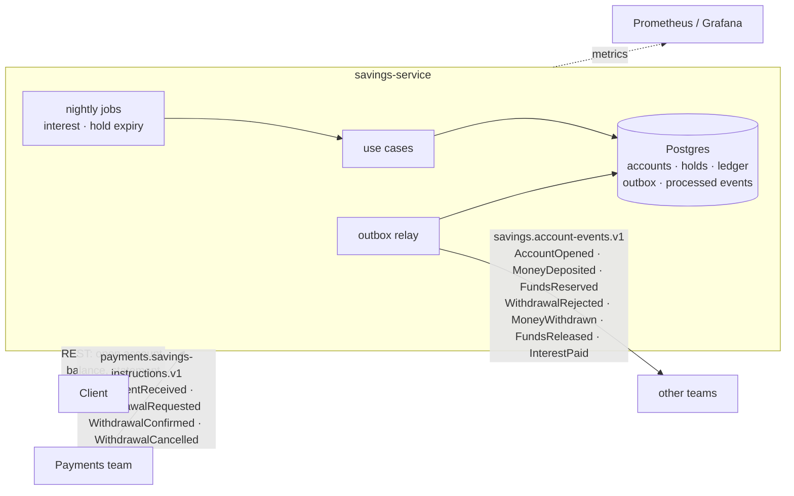
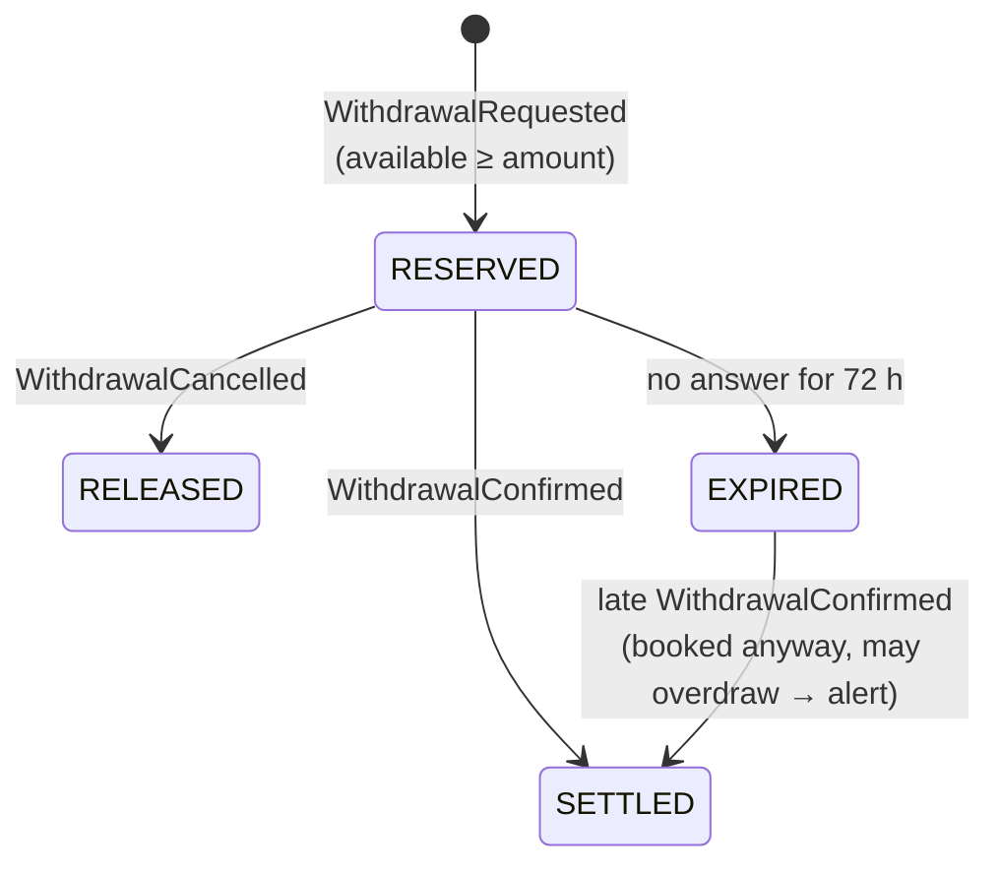

# savings-platform

A savings-account service in an event-driven architecture: accounts are opened over REST, money
moves in and out through instructions from a Payments team on Kafka, interest accrues daily and is
paid monthly. Built to be **correct and auditable** first, and as simple as that allows.

Java 25 · Spring Boot 4.2 · Hibernate 7 · Flyway · PostgreSQL 17 · Kafka 4 · Protobuf ·
Micrometer/Prometheus/Grafana · JUnit 6 · AssertJ · Mockito · Testcontainers · Karate · ArchUnit ·
Checkstyle · GitHub Actions

```
./gradlew build          # Checkstyle, unit, architecture and acceptance tests (needs Docker)
```

## What it does



- **Deposits** are credited when Payments reports a received transfer.
- **Withdrawals** are two-phase: reserve funds (a *hold*), then settle when Payments confirms the
  transfer or release when it cancels. Unanswered holds expire after 72 h; a confirmation that
  arrives after that is still booked, because the money has already left the bank.
- **Interest**: ACT/365 on each day's closing balance, accrued nightly with sub-cent precision,
  credited monthly rounded half-even, with the remainder carried over.



## Where the interesting decisions are

| Concern | How | Read |
|---|---|---|
| Exact money | `BigDecimal` value object, strings on the wire, half-even rounding only at payout | [ADR 0004](docs/adr/0004-money-and-append-only-ledger.md) |
| Auditability | Append-only ledger with `balance_after`; daily accrual rows | [0004](docs/adr/0004-money-and-append-only-ledger.md), [0010](docs/adr/0010-interest-accrual-and-payout.md) |
| No lost or phantom events | Transactional outbox, single ordered relay | [0006](docs/adr/0006-transactional-outbox.md) |
| At-least-once delivery | De-duplication marker in the business transaction; retries; dead-letter topic | [0007](docs/adr/0007-idempotent-consumer-and-dead-letters.md) |
| Concurrency | Per-account ordering via partition key, `@Version` optimistic locking, DB constraints | [0008](docs/adr/0008-ordering-and-concurrency.md) |
| Distributed workflow | Holds with expiry and the late-confirmation rule | [0009](docs/adr/0009-two-phase-withdrawals.md) |
| Big tables | Monthly partitions, one composite index, keyset pagination | [0011](docs/adr/0011-ledger-partitioning-and-keyset-pagination.md) |
| Contracts | Protobuf envelope with `oneof`, additive evolution, anti-corruption layer | [0005](docs/adr/0005-protobuf-event-contracts.md) |
| Architecture | Hexagonal layers, enforced by ArchUnit | [0003](docs/adr/0003-hexagonal-layers-with-jpa-on-the-domain.md) |
| Delivery | Acceptance tests first, real infrastructure in tests | [0012](docs/adr/0012-acceptance-tests-first.md) |
| Operations | Business metrics, dashboard, alerts | [0013](docs/adr/0013-observability.md) |
| What's left out, and why | Taxes, campaigns, auth, S3, ... | [0001](docs/adr/0001-scope-savings-only.md) |

All decisions: [docs/adr](docs/adr/README.md) · Vocabulary: [docs/GLOSSARY.md](docs/GLOSSARY.md)

## Repository layout

```
events-proto/         Protobuf contracts (inbound from Payments, outbound account events)
savings-service/      the service
  domain/             Account, Hold, LedgerEntry, Money, Interest: plain Java, no Spring
  application/        use cases and the ports they need
  adapter/            web · messaging · persistence · scheduling · metrics
  resources/db/       Flyway migrations
  test/.../acceptance Karate runner + TestHooks;  test/resources/acceptance/*.feature
payments-simulator/   CLI that plays the Payments team locally
ops/                  Prometheus config and alerts, Grafana provisioning and dashboard
docs/                 ADRs and glossary
```

## The specification

The acceptance features are the best entry point into the behaviour:

- [accounts.feature](savings-service/src/test/resources/acceptance/accounts.feature): opening, validation, problem details
- [deposits.feature](savings-service/src/test/resources/acceptance/deposits.feature): crediting, redelivery applied once, paginated statement
- [withdrawals.feature](savings-service/src/test/resources/acceptance/withdrawals.feature): reserve/confirm/cancel, rejection, contract violation → DLT
- [hold-expiry.feature](savings-service/src/test/resources/acceptance/hold-expiry.feature): 72 h expiry, late confirmation that overdraws
- [interest.feature](savings-service/src/test/resources/acceptance/interest.feature): monthly payout, catch-up from closing balances, carried remainders

## Running it locally

```bash
./gradlew :savings-service:bootJar
docker compose up --build
```

| | |
|---|---|
| API docs | http://localhost:8080/swagger-ui.html |
| Metrics | http://localhost:8080/actuator/prometheus |
| Prometheus (alerts) | http://localhost:9090/alerts |
| Grafana (dashboard "Savings") | http://localhost:3000 |

Play the Payments team:

```bash
ACCOUNT=$(curl -s -X POST localhost:8080/accounts -H 'Content-Type: application/json' \
  -d '{"customerId":"3f2b8c1a-5d4e-4f6a-9b7c-1a2b3c4d5e6f","annualRate":0.025}' | jq -r .id)

./gradlew -q :payments-simulator:run --args="deposit  $ACCOUNT 250.00"
./gradlew -q :payments-simulator:run --args="withdraw $ACCOUNT 100.00"     # prints requestId=...
./gradlew -q :payments-simulator:run --args="confirm  $ACCOUNT <requestId>"

curl -s localhost:8080/accounts/$ACCOUNT
curl -s localhost:8080/accounts/$ACCOUNT/transactions
```

## REST API

| Method | Path | |
|---|---|---|
| `POST` | `/accounts` | `{ "customerId": uuid, "annualRate": 0.0250 }` → `201` + `Location` |
| `GET` | `/accounts/{id}` | balance, held, available, accrued interest; amounts as strings |
| `GET` | `/accounts/{id}/transactions?limit=20&cursor=…` | newest first, keyset-paginated, `nextCursor` |

Errors are [RFC 9457](https://www.rfc-editor.org/rfc/rfc9457) problem details.
