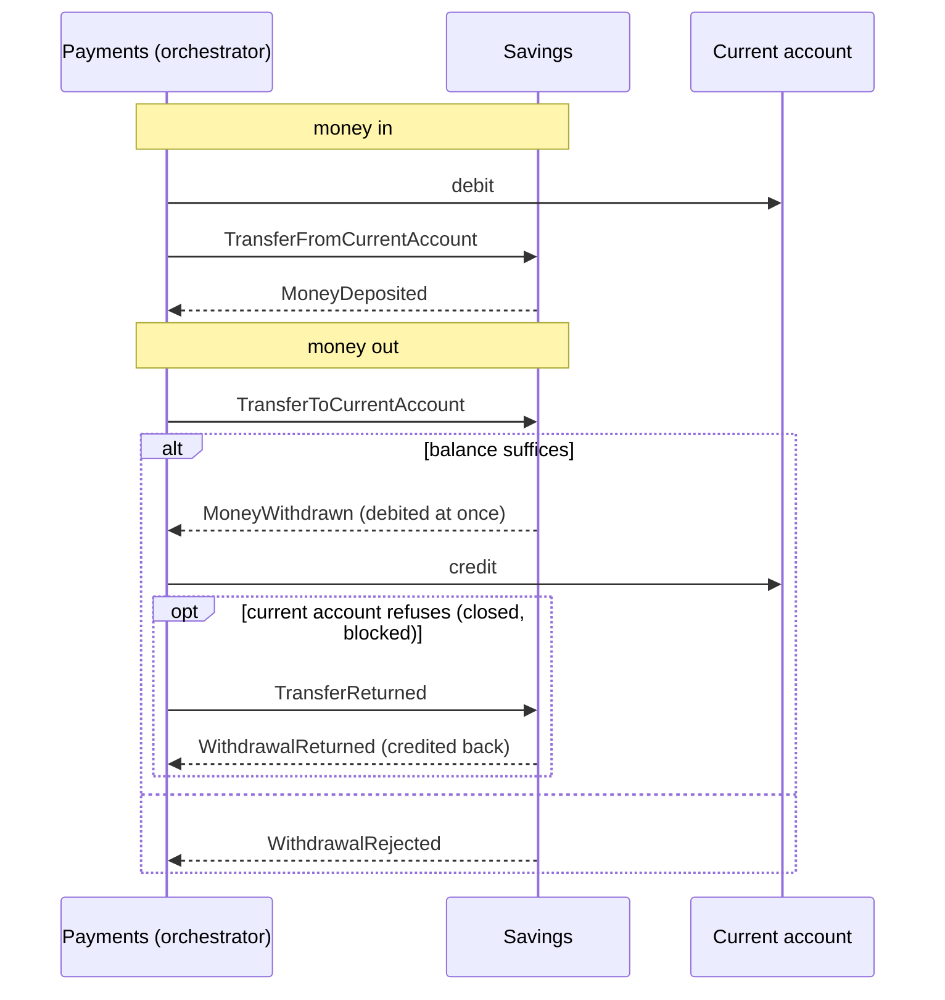

# 0015 – Savings moves money only to and from the customer's current account

Date: 2026-11-22 · Status: Accepted · Supersedes [0009](0009-two-phase-withdrawals.md)

## Context

ADR 0009 let Savings pay out through external transfers (SEPA, SPEI). The outcome of an external
transfer is uncertain for a while: executed, not yet, or never. Savings had to reserve funds (holds),
wait for a confirmation, expire unanswered holds after 72 h, and book confirmations that arrived after
expiry even if they overdrew the account. Most of the service's complexity and its worst failure
(an overdrawn savings account) came from that uncertainty, which isn't savings' business at all.

Savings products usually don't pay third parties anyway: German savings accounts (Tagesgeld) pay out
to the customer's reference account, and neobanks model savings as a balance next to the main account.

## Decision

**Savings only moves money between itself and the same customer's current account** at the bank.
External payments, cards and their uncertainty belong to the current account and Payments.

Payments orchestrates each transfer as a saga with one compensating step:

- **Single-phase withdrawals.** The outcome of an internal transfer is known at once, so Savings
  debits immediately or rejects. No holds, no expiry job, no late confirmations.
- **The balance can never go negative**: the account aggregate refuses it and the database checks it
  (`account.balance >= 0`).
- **Compensation is a credit, not an undo.** A returned withdrawal is a new ledger entry
  (`WITHDRAWAL_RETURN`) and a new posting; history stays append-only.
- **One `transfer` table** keyed by the transfer id Payments chooses: business-key idempotency (a
  re-sent transfer is applied once, a reused id with different content is dead-lettered), the state a
  return needs (only a completed withdrawal can come back, only once), and the lookup for
  reconciliation. It replaces both `hold` and the earlier `deposit` table.
- **Every instruction gets exactly one answer** carrying its transfer id, so Payments can treat our
  events as acknowledgements and time out on missing ones (ADR 0007).
- A rejected transfer id stays rejected; a new attempt needs a new transfer id. A re-send is never
  re-evaluated against a balance that changed in the meantime.

## Alternatives considered

- **Two-phase withdrawals to external accounts** (ADR 0009). Necessary when the outcome is uncertain;
  the cost is holds, an expiry policy, and either frozen funds or overdrafts when the answer comes late.
- **Payments' reconciliation decides expiry, Savings only escalates** (holds become `OVERDUE` instead
  of being released). Removes the overdraft risk, but keeps all the moving parts. Considered in the
  design discussion and dropped once the uncertainty itself could be removed.
- **One central ledger for all products** (current and savings accounts in one database): a transfer
  between them would be a single local transaction, no saga. Couples every product team to one schema
  and one release train; per-product ledgers fit an event-driven organisation better.

## Consequences

- Removed: `Hold`, the hold state machine, `HoldExpiryJob`, the 72 h TTL, late confirmations,
  `savings_negative_balance_total` and its alert.
- Money in flight between current account and savings sits on the `transfer-clearing` book account
  (ADR 0014); in a healthy system it nets to zero per transfer, counting both ledgers' postings
  (the current account doesn't post yet, ADR 0021).
- Savings depends on Payments to compensate a withdrawal the current account refused; until the
  `TransferReturned` arrives, the money is on `transfer-clearing`. Payments' daily reconciliation
  catches transfers stuck there.
- The pre-release contracts and migrations were rewritten rather than evolved, since nothing consumes
  them yet. After the first release, ADR 0005's additive-only rule applies.
- Verified by `withdrawals.feature` (immediate debit, rejection, no double spend, return once,
  re-send once, contract violations dead-lettered), `postings.feature`, `TransferTest`, `AccountTest`
  and `PaymentInstructionHandlerTest`.
