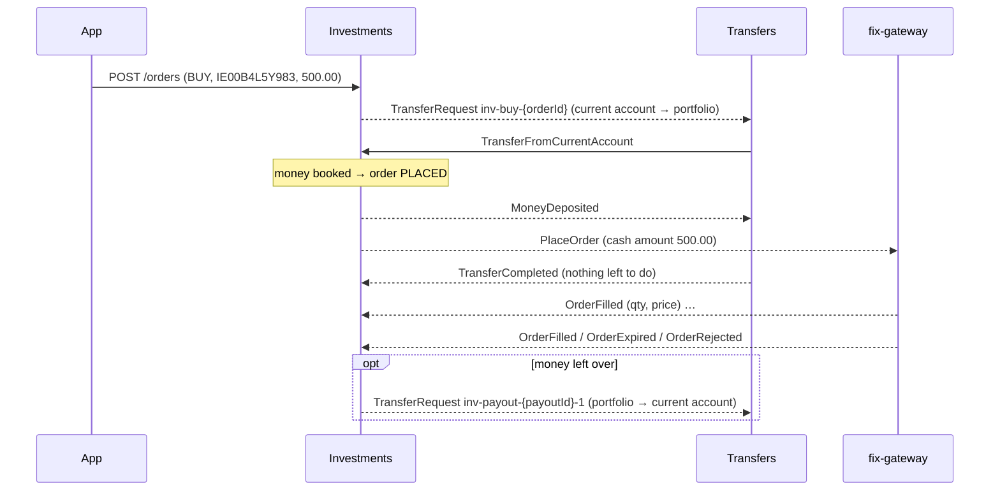

# 0026 – The investment service: portfolios, orders by amount, FIFO holdings

Date: 2026-11-24 · Status: Accepted · Amends [0001](0001-scope-savings-only.md), [0008](0008-ordering-and-concurrency.md) (portfolio lock), [0018](0018-service-structure.md) · Broker connection: [0027](0027-fix-gateway.md) · Transfers: [0028](0028-investments-as-a-third-ledger.md)

## Context

ADR 0001 left investments out as "a different aggregate (orders, holdings, FIFO cost basis)" for a
separate service, and the big picture shows it as planned, with its own ledger, asking the transfer
service for money. Savings, transfers and current accounts now run end to end, so the question is
how securities fit into the same platform without bending its rules.

Securities differ from savings in one way that shapes everything else: **the outcome of an order is
uncertain for a while.** A market order is placed with a broker; it is filled, partly filled,
rejected or expires, and the price is known only when the fill is reported. ADR 0015 removed holds
from savings because an internal transfer's outcome is known at once. Here the uncertainty is the
domain's own, so it has to be handled here, and kept from leaking into the current account.

## Decision

**Build `investment-service` (port 8083), owning portfolios, orders and holdings in its own
database.** It follows the same template as `current-account-service`: hexagonal layers with a
plain-Java domain (ADR 0016), its own command log `investments.commands.v1` (ADR 0019), `POST` with
an `Idempotency-Key` (ADR 0025), the outbox and idempotent consumer from `platform-messaging`
(ADR 0022), and only Kafka between services (ADR 0018).

**What is sold.** Self-directed buying and selling of ETFs and stocks, one market order at a time.
Instruments come from Flyway reference data keyed by ISIN (name, type `ETF` or `STOCK`), traded in
EUR only. An instrument can be taken off sale from a given time, as a product can (ADR 0024): buys
of it are refused, sells are still allowed, so nobody is locked into a holding.

**A portfolio is opened explicitly** with `POST /portfolios`, `{ customerId, referenceAccountId }`.
The reference account is the customer's current account; every refund and every sale's proceeds go
there, and it never changes in this slice. Opening publishes `PortfolioOpened`, from which the
transfer service learns the portfolio as an account of a third ledger (ADR 0028). That the reference
account belongs to the customer is checked where it is for savings: by the transfer service's
ownership rule, on the first transfer.

**No cash account. Each buy brings its own money, and the money comes first.**

- A **buy is sized by amount** ("€500 of this ETF"). The amount is pulled from the current account
  through the transfer service *before* the order is placed, so the bank never pre-finances a
  customer's order and a refused debit fails the order before anything was traded
  (`FUNDING_FAILED`). The order goes to the broker as soon as its money is booked on the portfolio,
  not when `TransferCompleted` arrives: crediting the portfolio is the saga's last step and a
  product ledger never refuses a credit (ADR 0028), so the money can't be taken back.
- The broker fills a fractional quantity for at most that amount (`CashOrderQty`, ADR 0027). Whatever
  isn't spent (the order expired or was rejected, partly or wholly, or the fills cost less) is
  **refunded** to the reference account by a transfer the investment service requests.
- A **sell is sized by quantity**. It may not exceed the **free quantity**: the holding minus what
  open sells have reserved, so two concurrent sells can't sell the same shares. The proceeds of
  every fill are paid out to the reference account once the order is final.
- So the portfolio holds money only while an order is in flight. The one exception: if the current
  account refuses a refund or payout (it was blocked meanwhile), the transfer service returns the
  money (ADR 0015's compensation) and it stays on the portfolio as an **unpaid payout**, visible in
  the API, never usable for buying. It is retried when the current account is unblocked and once a
  day; an alert fires when one is older than three days.
- Money that arrives with no order waiting for it (another transfer to the portfolio, or a funding
  whose amount doesn't match its order) is accepted, as a credit to a product ledger always is
  (ADR 0028), and paid straight back as a payout of its own (`UNEXPECTED_DEPOSIT`), so it never rests
  on the portfolio. A funding of another amount also ends its order as `FUNDING_FAILED`: the order
  can't be funded again under the same transfer id.

**An order's trading state and its money are tracked separately.**

| Side | Trading status | Settlement |
|---|---|---|
| Buy | (`RECEIVED`) → `FUNDING` → `PLACED` → `PARTIALLY_FILLED` → `FILLED`, `EXPIRED` or `REJECTED`; or `FUNDING_FAILED` | `PENDING` until the refund (if any) is done, then `SETTLED`; `UNPAID` if the refund came back |
| Sell | (`RECEIVED`) → `PLACED` → `PARTIALLY_FILLED` → `FILLED`, `EXPIRED` or `REJECTED`; or `REJECTED` at once (not enough free quantity, unknown portfolio) | `PENDING` until the proceeds are paid out, then `SETTLED`; `UNPAID` if the payout came back |

`RECEIVED` is what `POST /orders` answers while the command is on the log (ADR 0019): the order
doesn't exist yet, so it is not a status the order is stored with. Applying the command creates it
`FUNDING` (a buy), `PLACED` (a sell) or `REJECTED`.

An order is done when its trading status is final and its settlement is `SETTLED` or `UNPAID`.
Customers can't cancel an order in this slice: it is filled, rejected or expires at the end of its
trading day. The trading day is the Berlin business day the order was placed on; every weekday is
one (no exchange holiday calendar yet). An order placed on a weekend trades on the Monday after.

**Holdings are lots, consumed FIFO.** Each buy fill adds a lot (quantity, cost, trade time) to the
portfolio's holding in that instrument. A sell fill consumes lots oldest first and splits the lot it
ends in. Its **realised gain** is the fill's proceeds minus the FIFO cost of the lots it consumed,
recorded per fill. The holding shows quantity, cost basis (sum of the remaining lots' cost) and the
last fill price; there is no market data feed, so no market value.

**Precision.** Quantities have 6 fraction digits, as the broker reports them; we never round a
quantity. Prices have 4. An order's fills are summed exactly (`quantity × price`, 10 fraction digits),
and that total is rounded half-even to the cent once, for the order: a fill's amount, the money it
moves, is what the rounded total grew by. Rounding each fill on its own could take a buy a cent beyond
its money when the broker's exact total is within it; rounded once, a buy's fills never cost more than
it brought. A fill worth less than a cent (`0.000001 × 96.00`) moves no money: its units are added or
sold, with a lot cost or proceeds of zero, and nothing is booked. A lot's remaining cost is kept with
10 fraction digits so partial sells don't drift; realised gains are rounded to the cent when booked.
Minimum buy: €1.00.

**Idempotency, as elsewhere (ADR 0007).** The order id is derived from the `Idempotency-Key`
(`ord-…`); the broker order id is the order id, and a buy's funding is `inv-buy-<order id>`. Refunds
and proceeds are payouts, one per order with an id derived from the order's, and each attempt to pay
one is a transfer of its own, `inv-payout-<payout id>-<attempt>`: the transfer service applies a
transfer id once and a refused one stays refused (ADR 0015), so a retry needs a new id. Fills are
applied once per execution id, transfer answers once per transfer id. A reused id with different
content is dead-lettered.

**Concurrency: one lock per portfolio, not optimistic locking.** This amends ADR 0008 for the
investment service. A portfolio's inputs arrive on five topics keyed differently (portfolio, order,
transfer id, current account), so one portfolio's messages are consumed by several threads at once,
and most of them change several rows together: an order, its fills, a holding and its lots, a
payout, the money ledger. Every use case that changes a portfolio's state first locks the portfolio
row (`select … for update`) and re-reads under the lock; the lock is held only for that one
transaction, which never waits on the network (the outbox sends afterwards). Optimistic versions on
each of those rows would make conflicts (a fill racing a transfer answer on the same portfolio)
retries of whole messages for a gain nobody would notice: a portfolio sees a handful of messages per
order. The database invariants of ADR 0008 point 3 stay: `cash >= 0`, `filled_value <= amount`, keys
on execution id and transfer id.

**Inputs and outputs.**

| Topic | Direction | Carries |
|---|---|---|
| `investments.commands.v1` | in (own log) | `OpenPortfolio`, `PlaceOrder` from REST |
| `payments.investment-instructions.v1` | in | the transfer service's instructions to the portfolio ledger (ADR 0028) |
| `payments.transfer-events.v1` | in | outcomes of the transfers investments requested |
| `current-account.events.v1` | in | `CurrentAccountUnblocked`, to retry unpaid payouts |
| `broker.executions.v1` | in | fills, rejections, expiries from the gateway (ADR 0027) |
| `investments.account-events.v1` | out | `PortfolioOpened`; answers to the transfer service's instructions |
| `payments.transfer-requests.v1` | out | buys' funding, refunds and payouts |
| `broker.orders.v1` | out | `PlaceOrder` to the gateway |
| `investments.postings.v1` | out | double-entry postings for Finance |

**Business metrics** (ADR 0013), behind the port `InvestmentMetrics`: `investments_orders_received_total`
and `investments_orders_ended_total` `{side, status}`, `investments_fills_total` and
`investments_fills_amount_euros_total` `{side}`, `investments_payouts_requested_total` and its volume,
`investments_payouts_refused_total{reason}` and `investments_messages_duplicate_total`; next to the
gauges `investments.orders.overdue` and `investments.payouts.unpaid.overdue`, which have alerts.

**Postings for Finance, money only.** Every money movement is published as a balanced posting, as
savings does (ADR 0014): money in and out moves between `customer:<id>` and `transfer-clearing`;
fills move it between `customer:<id>` and `broker-settlement`. Securities are held in custody for
the customer, off the bank's balance sheet, so holdings and lots are not posted.

**Deliberately left out**, in the spirit of ADR 0001:

| Omitted | What it would take |
|---|---|
| Market valuation, price feeds | A market-data consumer and a valuation per holding; nothing in the ledger changes. |
| Dividends, corporate actions (splits, mergers) | Cash income events paid out like proceeds; lot adjustments that keep FIFO order. |
| Taxes on gains (Abgeltungsteuer) | Withholding at payout from realised gains, per customer and tax year, with the allowance shared with savings interest. |
| Limit and stop orders, cancellation | A limit price on the order and the funding sized by it; a cancel request through the gateway, racing fills. |
| Savings plans | A schedule that places buy orders. |
| Fees | A fee added to a buy's cost and taken from a sale's proceeds, posted to a fee income account. |
| Suitability and appropriateness checks (MiFID II) | A customer profile checked before an order is accepted. |
| Bundling orders into block orders | Allocation of block fills to portfolios (ADR 0027). |
| Exchange holiday calendar | A calendar for the trading day. |

## Consequences

- The platform gets its first process whose outcome is uncertain, and the uncertainty stays inside
  the investment service and the gateway: the current account still only sees debits and credits
  with known outcomes.
- A buy needs two transfers when it isn't fully filled (in, then refund), and the customer's
  current account shows both. That is the price of having no cash account; one would make a refund
  a booking instead of a transfer, at the cost of a cash ledger, holds against it and interest
  questions.
- Money in flight sits on `transfer-clearing` between the ledgers and on `broker-settlement` between
  us and the broker; both net to zero per order in a healthy system, which Finance can reconcile.
- An unpaid payout is the one place a customer's money can rest on a portfolio; it is retried and
  alerted on, never spent.
- The transfer service learns a third ledger (ADR 0028); the current account doesn't change.

## Alternatives considered

- **A cash account in the portfolio** (topped up from the current account, buys reserve against
  it, proceeds stay there). The usual brokerage design; rejected for now as more ledger than this
  slice needs: refunds and proceeds go straight back to the current account.
- **Execute first, then debit the current account.** Faster for the customer, but a refused debit
  leaves the bank holding shares nobody paid for.
- **Buys by quantity** with a buffer pulled up front, or with a limit price. Either leaves money to
  refund on nearly every order, or brings in limit orders.
- **A rule in the transfer service for buying securities.** The transfer service moves money and
  knows accounts, not products (ADR 0018).
